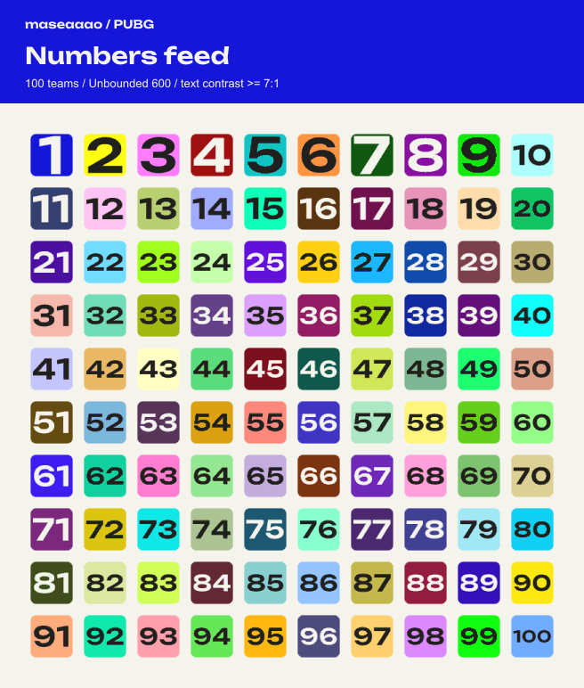
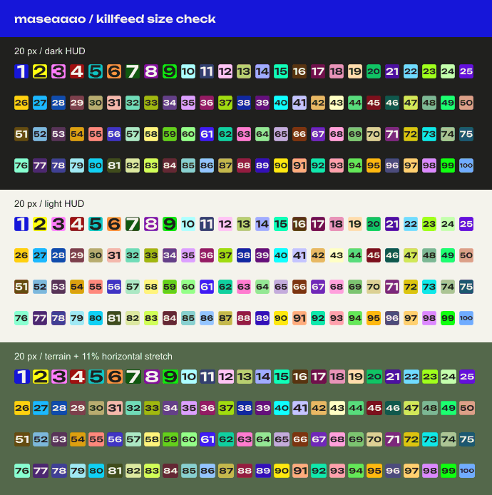

# PUBG Numbers Feed

100 numbered killfeed team icons for **PUBG: BATTLEGROUNDS** — big, high-contrast team digits in distinct colors, with the typography and rounded tiles of **maseaaao.tv**.



## Why numbers

Flags require memorizing 100 flag-to-team mappings. Numbers don't: the team digit is the icon. Each team gets its own color so entries can be told apart at a glance, while the digit itself stays the primary identifier.

## Features

- **100 icons** (`001.png`–`100.png`) covering squads, duos and solos
- **Unbounded SemiBold (600)** from the main brand, auto-fitted for 1-, 2- and 3-digit team numbers
- **100 unique team colors** — deterministic farthest-point selection in OKLab, starting with brand blue `#1616D9`; each new color maximizes its distance from the colors already selected. No duplicate RGB colors. Similar shades remain possible in a 100-team set: the number is always the primary identifier.
- **Verified contrast >= 7:1** — each background is paired with warm light `#F4F3EC` or dark ink `#20201E`, whichever gives the higher contrast; candidates below 7:1 are rejected
- **Clean brand typography** — solid fills, no outlines or shadows, transparent rounded corners, and spacing between digits
- **Lightweight** — palette-quantized PNGs, ~1.4 KB per icon
- **Observer-ready** — `Teaminfo.csv` and folder layout match what the game expects



## Install (into the game)

1. Get the repo (clone, or download a [release](../../releases) zip and unzip it)
2. Open Windows Explorer and paste into the address bar:
   ```
   %LOCALAPPDATA%\TslGame\Saved
   ```
3. Copy the `Observer` folder there. It should contain `TeamIcon` and `Teaminfo.csv`
4. Play

## Build from source

Requires Node.js 24+. `node-canvas` is the only npm dependency (outline rasterization); PNG encoding and zip packaging are built in-repo on top of `node:zlib`, and every generated icon passes a decode roundtrip check (worst channel deviation from nearest-palette quantization is capped at 40/255) before it is written.

```bash
npm ci
npm test
npm run generate
```

Outputs:

- `Observer/` — icons + `Teaminfo.csv` (paste this into the game)
- `preview/` — branded contact sheet, all 100 numbers at 20 px on three backgrounds (including horizontal stretch), and `palette.json` with per-team colors and contrast ratios
- `dist/pubg-numbers-feed-v<version>.zip` — ready-to-share archive with the `Observer` folder

Layout lives in `src/generate.js`; palette rules and shared brand colors live in `src/palette.js`. Re-run generation after changes. The CSV uses exactly the same background colors as the icons.

## Typography

Unbounded SemiBold (600), shared with the local maseaaao.tv project. Every icon is a 64 x 64 rounded tile (8 px radius) with transparent corners. Digit spacing is 0.025 em; the font size adapts to the available width and height.

The bundled static font and its SIL OFL 1.1 license are in `src/assets/fonts/Unbounded-SemiBold.ttf` and `Unbounded-OFL.txt`. `unbounded-600-glyphs.json` contains the original glyph outlines. `src/lettering.js` draws those paths directly, avoiding silent font substitutions by Windows/Pango. Normal builds need no installed fonts or Python. To update the outline data after replacing the font, install Python `fonttools` and run `python scripts/extract-font.py`.

The previews cover light/dark HUDs and a terrain-like background, with an additional 11% horizontal stretch. Actual PUBG rendering still needs an in-game check, especially team 100 at small killfeed scales. This release only updates the project and ZIP; it does not overwrite the game's installed Observer folder.

## Credits

- Install flow and `Observer` layout follow [nitnat/pubg-flagfeed](https://github.com/nitnat/pubg-flagfeed), the project that inspired this one
- Original custom killfeed icon idea: [Kowo](https://youtu.be/8OWbQ_wXhpk)

## License

- Code and generated icons: [MIT](LICENSE)
- Bundled font (`src/assets/fonts/`): SIL OFL 1.1
